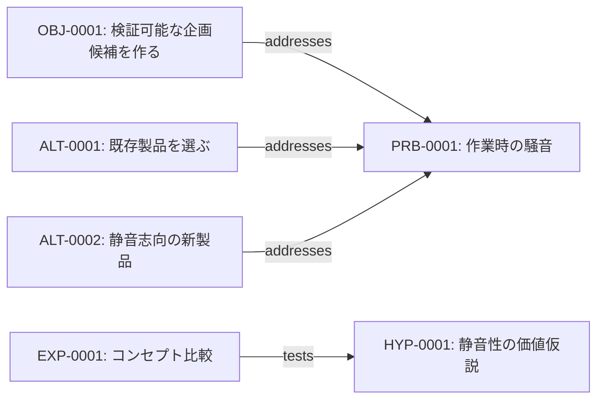

# 図の投影仕様

> **候補データからの自動投影**｜対象：架空の静音デスクファンの市場企画｜実顧客・市場の実証結果ではない。

## 要素と関係のグラフ（候補）

図は全要素の一部のみ示す。因果状態と出典状態はJSONを正本とする。

## 解釈上の注意

この図のエッジは型付きの候補関係。`causally_influences`は仮説・観測・実験推定を区別する。図の近接や矢印は因果効果の証明にならない。
